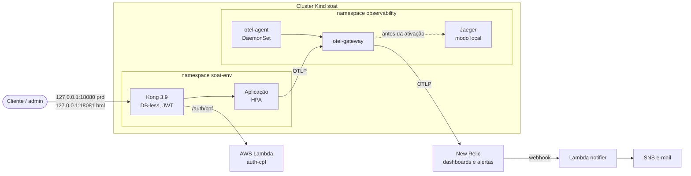

# soat-infra-k8s

Infraestrutura Kubernetes da oficina, parte da Fase 3 do Tech Challenge 13SOAT: **cluster,
gateway de API e observabilidade**, tudo por Terraform.

| Repositório | Papel |
|---|---|
| [fiap-software-architecture](https://github.com/gomes-leonardo/fiap-software-architecture) | Aplicação principal (NestJS) no Kubernetes |
| [soat-auth-lambda](https://github.com/gomes-leonardo/soat-auth-lambda) | Funções serverless: autenticação por CPF e notificação |
| [soat-infra-db](https://github.com/gomes-leonardo/soat-infra-db) | Banco gerenciado (Neon PostgreSQL) |

## Arquitetura



| Diretório | O que cria | State |
|---|---|---|
| `cluster/` | Cluster Kind `soat` (1 control-plane + 1 worker), namespaces `soat-hml`, `soat-prd` e `observability`, ResourceQuota e LimitRange por ambiente, metrics-server para o HPA | local, na máquina do runner |
| `gateway/` | Por ambiente: Kong DB-less em NodePort, segredo JWT (Secret `soat-jwt`, SSM e consumers do Kong) e, no modo `lambda`, o segredo de origem lido do SSM | S3 |
| `observability/` | OpenTelemetry Collector em dois papéis (agent DaemonSet e gateway) e Jaeger | S3 |
| `newrelic/` | Por ambiente: dashboards de negócio e de operação, 5 alertas e o webhook para o notifier | S3 |
| `reference/aws-eks/` | **Referência, nunca aplicada:** o mesmo desenho em EKS, que custaria dinheiro | — |

### Gateway

O Kong nega por padrão: só existem as rotas declaradas em
[`gateway/templates/kong.yml.tftpl`](gateway/templates/kong.yml.tftpl).

- **Públicas:** `/health`, `/auth/login`, `/auth/cpf`, `/consult` e `/webhooks`. O webhook tem
  segredo próprio, conferido pela aplicação.
- **Com JWT:** `/clients`, `/vehicles`, `/services`, `/parts`, `/service-orders`, `/budgets`, `/me` e
  `POST /auth/register`. Qualquer outro caminho recebe 404 do próprio Kong. O plugin `jwt` identifica o emissor pelo `iss` do token: `soat-app`
  para admin e `soat-auth-lambda` para cliente. O papel é conferido pela aplicação.
- **`/auth/cpf`:** vai para a Lambda de autenticação, com rate limit de 10/min. O Kong apaga o
  header `x-soat-origin` vindo do cliente e põe o segredo de origem, que só ele e a função conhecem.
- **Swagger** (`/api-docs`): só em hml.

Até a ativação da AWS, `auth_mode = local` manda `/auth/cpf` para um substituto que roda no cluster,
com o mesmo código da Lambda.

### Observabilidade

A aplicação envia traces, métricas e logs por OTLP. O agent de cada nó lê os logs dos containers
e as métricas do kubelet. O gateway raspa o `/metrics` dos pods anotados, mede o `/health` pelo
Kong de cada ambiente e lê o estado do cluster. Tudo sai pelo gateway.

| `newrelic_enabled` | Traces | Métricas | Logs |
|---|---|---|---|
| `false` (padrão) | Jaeger no cluster | endpoint Prometheus `:8889` | stdout do collector |
| `true` | New Relic | New Relic | New Relic |

Alertas, limiares e o roteiro para provocar cada um: [newrelic/ALERTAS.md](newrelic/ALERTAS.md).

## Tecnologias

Terraform (providers `tehcyx/kind`, `hashicorp/kubernetes`, `hashicorp/helm`, `hashicorp/aws`,
`newrelic/newrelic`), Kind, Kong 3.9, OpenTelemetry Collector contrib (chart
`opentelemetry-collector`), Jaeger, New Relic e GitHub Actions com runner self-hosted e OIDC na AWS.

**Custo zero:** o cluster roda no Docker do Mac em vez de EKS. A NAT Gateway e o control plane do
EKS sozinhos já passariam de US$ 100/mês. O New Relic fica no plano gratuito (100 GB/mês), e o SSM
no tier Standard.

## Deploy

| Evento | O que roda |
|---|---|
| Pull request para `develop` ou `main` | `fmt`, `validate` de todos os diretórios e `kong config parse` do gateway nos dois modos (GitHub-hosted) |
| Push em `develop` | plan do cluster e da observabilidade; apply do gateway **hml**; New Relic hml se ativado |
| Push em `main` | apply do cluster e da observabilidade; apply do gateway **prd**; New Relic prd se ativado |

O cluster é aplicado em dois passos: primeiro só o `kind_cluster`, depois o resto. Os providers
kubernetes e helm precisam do contexto `kind-soat`, que só existe depois do primeiro passo.

**Pré-requisitos:**
- o cluster e a observabilidade de pé: quem os cria é o push em `main` (ou a execução manual
  abaixo). `develop` só planeja os dois, e o hml pressupõe que já existam;
- runner self-hosted com label `soat-kind` no Mac onde roda o Docker;
- variável `AWS_ROLE_ARN`, criada pelo bootstrap do `soat-auth-lambda`;
- Environments `hml` e `prd`, presos às branches `develop` e `main`.

| Configuração | Onde | Uso |
|---|---|---|
| `AWS_ROLE_ARN` | variável do repositório | state no S3 e SSM |
| `AUTH_MODE`, `AUTH_FUNCTION_URL` | variáveis de cada Environment | `lambda` + Function URL depois do deploy do `soat-auth-lambda` |
| `NEW_RELIC_ENABLED` | variável do **repositório** (não do Environment: o `if:` do job não enxerga variável de Environment) | `true` liga o export e os jobs do New Relic |
| `NEW_RELIC_ACCOUNT_ID` | variável do repositório | conta do New Relic |
| `NEW_RELIC_LICENSE_KEY`, `NEW_RELIC_API_KEY` | secrets do repositório | ingestão (collector) e API (alertas e dashboards) |

### Ativar o New Relic

1. Criar a conta gratuita em [newrelic.com](https://newrelic.com). Anotar o Account ID e gerar
   uma Ingest License Key e uma User API Key.
2. Cadastrar:
   ```bash
   gh variable set NEW_RELIC_ACCOUNT_ID --body <id>
   gh secret set NEW_RELIC_LICENSE_KEY
   gh secret set NEW_RELIC_API_KEY
   gh variable set NEW_RELIC_ENABLED --body true
   ```
3. Fazer push em `develop` e depois em `main`. Conferir os itens de
   [ALERTAS.md › Conferências na ativação](newrelic/ALERTAS.md#conferências-na-ativação).

### Execução manual

```bash
terraform -chdir=cluster init -backend-config="path=$HOME/.soat-tfstate/cluster.tfstate"
terraform -chdir=cluster apply -target=kind_cluster.this
terraform -chdir=cluster apply

terraform -chdir=gateway init \
  -backend-config="bucket=soat-tfstate-933643054958" \
  -backend-config="key=soat-infra-k8s/gateway/hml/terraform.tfstate"
terraform -chdir=gateway apply -var environment=hml

terraform -chdir=observability init \
  -backend-config="bucket=soat-tfstate-933643054958" \
  -backend-config="key=soat-infra-k8s/observability/terraform.tfstate"
TF_VAR_newrelic_enabled=true TF_VAR_newrelic_license_key=... terraform -chdir=observability apply

terraform -chdir=newrelic init \
  -backend-config="bucket=soat-tfstate-933643054958" \
  -backend-config="key=soat-infra-k8s/newrelic/hml/terraform.tfstate"
TF_VAR_newrelic_account_id=... TF_VAR_newrelic_api_key=... \
  terraform -chdir=newrelic apply -var environment=hml

bash scripts/check-kong-config.sh   # valida o kong.yml renderizado com a imagem kong:3.9
```

## Links

- Swagger da API: [docs/swagger.json](https://github.com/gomes-leonardo/fiap-software-architecture/blob/main/docs/swagger.json)
- Postman: [docs/postman-collection.json](https://github.com/gomes-leonardo/fiap-software-architecture/blob/main/docs/postman-collection.json)
- Deploys: o resumo de cada run nas [execuções do Actions](https://github.com/gomes-leonardo/soat-infra-k8s/actions).
  Não há URL pública: por custo zero, o cluster é um Kind no Mac do projeto, e os gateways ficam em
  `http://127.0.0.1:18080` (prd) e `http://127.0.0.1:18081` (hml).
